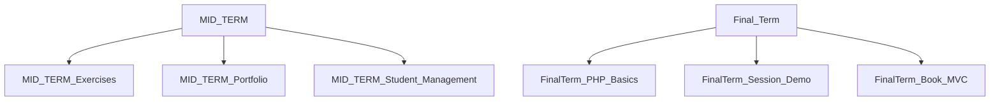

## 1. Stack
- Front end: plain HTML, CSS, vanilla JavaScript (no framework, no bundler).
- Back end: plain PHP (no framework, no Composer autoload — confirmed by absence of any manifest file).
- No package.json / composer.json / go.mod / pyproject.toml / Cargo.toml found anywhere in the repo (checked root and one level down).
- Local run: PHP's built-in server (`php -S localhost:8000`), per README.md.

## 2. Directory map
| path | what lives there |
|---|---|
| README.md | Course/repo description + local-run instructions |
| MID TERM/ | Mid-term unit: static HTML/CSS/JS lab exercises |
| MID TERM/Lab_Task_1.1 .. Lab_Task_3.2, Lab_Task_14-03-2026 | Small numbered HTML/CSS/JS exercises, one folder each |
| MID TERM/LAB_TASK_01.html .. Lab_Task_05.html | Standalone single-file HTML exercises at MID TERM root |
| MID TERM/Lab_Task_Portfolio/ | Personal portfolio site (index.html, style.css, script.js, Image/) |
| MID TERM/Student_Management/ | Small JS student-management app (index.html, app.js, style.css) |
| MID TERM/PDF/ | Lab task instruction PDFs (reference material) |
| MID TERM/IMAGE/ | Images used by the standalone lab HTML files |
| Final Term/ | Final-term unit: PHP lab exercises |
| Final Term/Php language/ | PHP basics (Variables/Operations/controlFlow) + PHP form-validation examples |
| Final Term/Lab Task (Understand Session cokkiee)/ | Session/login/dashboard/logout PHP demo, "Lab Task" + "Sample Task" variants |
| Final Term/Lab Task/ | task.md only (assignment description) |
| Final Term/LabTask(08.05.2026)/ | PHP "Book" app split into Controllers/, Model/, View/, config/ |

## 3. Diagram

## 4. Component index
- [[MID_TERM]]
- [[Final_Term]]
- [[MID_TERM_Exercises]]
- [[MID_TERM_Portfolio]]
- [[MID_TERM_Student_Management]]
- [[FinalTerm_PHP_Basics]]
- [[FinalTerm_Session_Demo]]
- [[FinalTerm_Book_MVC]]

## 5. Entry points
- Dev, static labs: open a lab's `index.html` directly, e.g. `MID TERM/Lab_Task_Portfolio/index.html`, `MID TERM/Student_Management/index.html`.
- Dev, PHP labs: run `php -S localhost:8000` (README.md) from inside the relevant PHP folder, then browse to its entry file, e.g. `Final Term/LabTask(08.05.2026)/View/index.php`, `Final Term/Lab Task (Understand Session cokkiee)/Lab Task/login.php`.
- No production entry point observed — no deploy/build config exists in the repo.

## 6. Conventions (observed only)
- Each static lab folder is self-contained: its own `index.html` (+ `style.css`, optionally `script.js`/`app.js`), e.g. `MID TERM/Lab_Task_1.1/`, `MID TERM/Lab_Task_Portfolio/`.
- Folder/file naming is inconsistent: `Lab_Task_1.1` (dotted) vs `LAB_TASK_01.html` (padded, all-caps) vs `Lab_Task_14-03-2026` (dated) all coexist under `MID TERM/`.
- Naming typos observed as real filenames: `MID TERM/Lab_Task_3.2/Lab_Task_O8.js` (letter O, not zero).
- The one structured PHP app (`Final Term/LabTask(08.05.2026)/`) is split by role: `Controllers/`, `Model/`, `View/`, `config/` (holds `db.php` + `database.sql`).
- The session-demo folder (`Final Term/Lab Task (Understand Session cokkiee)/`) contains two parallel copies, `Lab Task/` and `Sample Task/`, each with its own `login.php`/`dashboard.php`/`logout.php`/`index.html`.

## 7. Where things go
- New mid-term static exercise → new `MID TERM/Lab_Task_X.X/` folder with its own `index.html` (+ `style.css`/script), mirroring existing `Lab_Task_*` folders.
- New PHP-basics example → add a `.php` file under `Final Term/Php language/php Basic/` or `Final Term/Php language/PHP Forms /`.
- Extend the Book app → controller in `Final Term/LabTask(08.05.2026)/Controllers/`, model in `.../Model/`, view in `.../View/`, DB access via `.../config/db.php`.
- New session/auth demo → new folder under `Final Term/`, following the `login.php` / `dashboard.php` / `logout.php` pattern in `Final Term/Lab Task (Understand Session cokkiee)/Lab Task/`.
- New reference material → PDFs into `MID TERM/PDF/`, images into `MID TERM/IMAGE/` or the lab's own `Image/` subfolder (as in `Lab_Task_Portfolio/Image/`).
